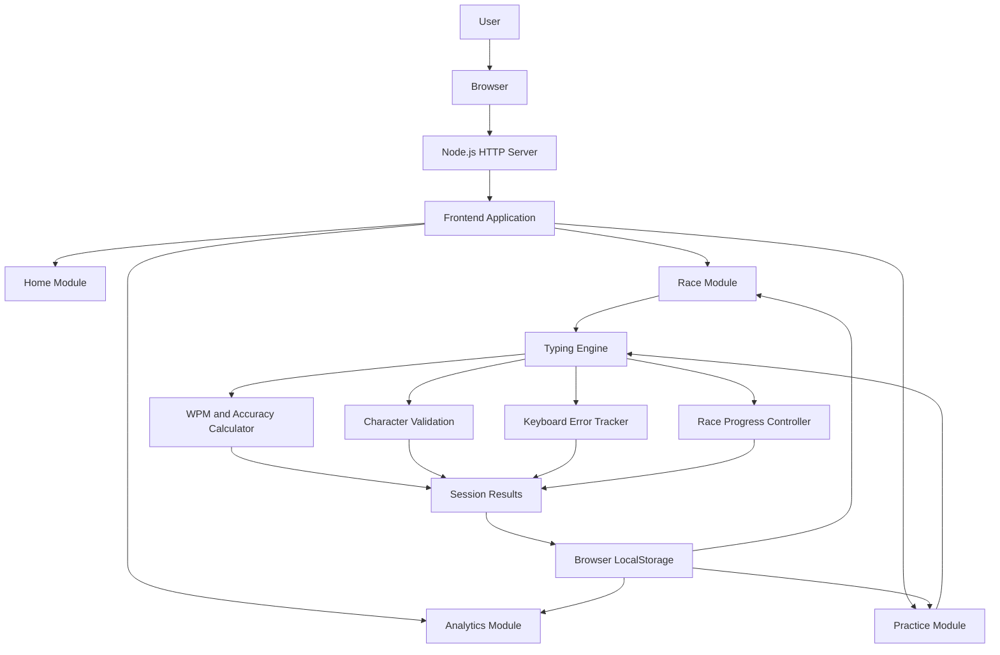
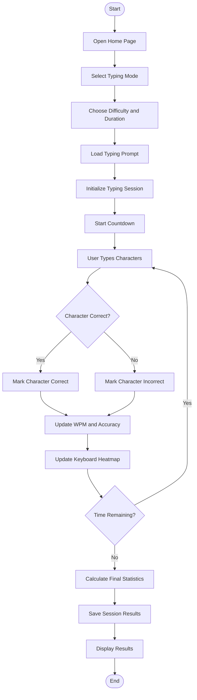
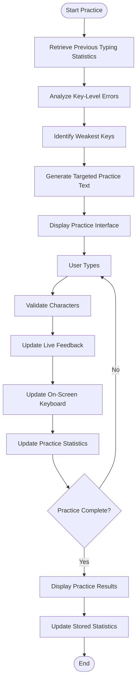
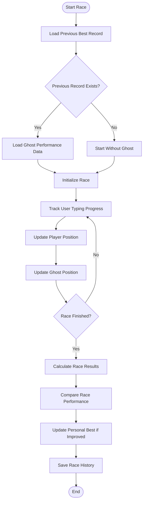
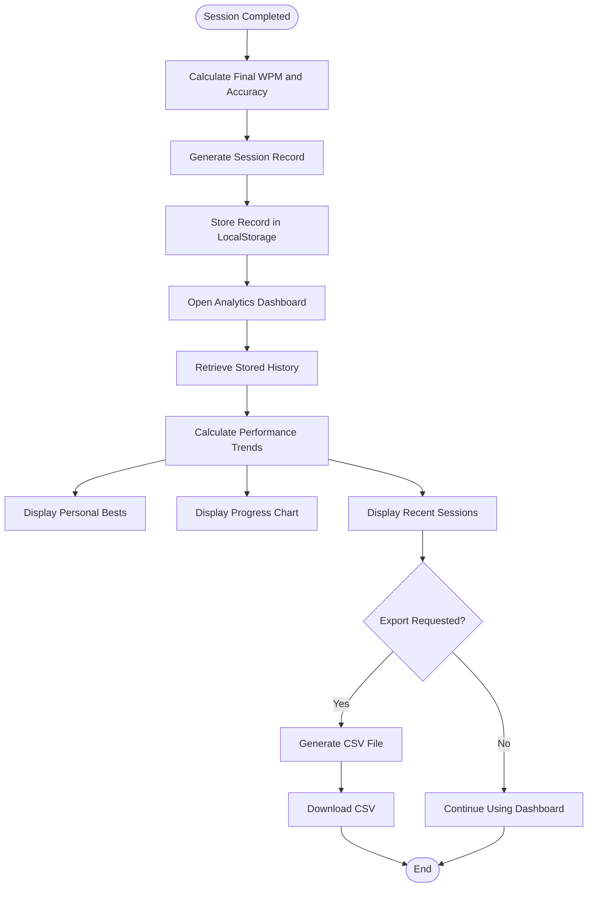
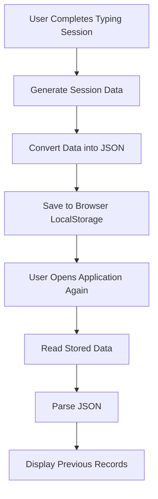

# TYPE.E — Arcade-Inspired Typing Speed Trainer

<p align="center">

  **TYPE SMARTER. IMPROVE FASTER.**

  An arcade-inspired typing platform that transforms ordinary typing practice into a competitive racing experience.

</p>

---

## About The Project

**Type.e** is an arcade-inspired typing speed trainer designed to make improving typing speed, accuracy, and consistency more engaging and measurable.

Traditional typing tests generally focus on displaying Words Per Minute (WPM) and accuracy. Type.e takes this concept further by combining real-time typing analytics, gamification, personalized practice, and a racing-inspired interface.

Users can participate in timed typing challenges, compete against their previous best performances through a ghost racing system, identify frequently mistyped keys using a keyboard heatmap, and practice specific weaknesses through targeted exercises.

The platform also introduces a dedicated **Programming Mode**, where users can improve their typing skills by working with actual code snippets from different programming languages.

Rather than simply measuring how fast someone types, Type.e helps users understand their typing habits, locate areas that need improvement, and track their progress over time.

**Measure. Locate. Improve.**

---

## Table of Contents

- [Key Features](#key-features)
- [Application Modules](#application-modules)
- [How It Works](#how-it-works)
- [System Architecture](#system-architecture)
- [Application Flowcharts](#application-flowcharts)
- [Technology Stack](#technology-stack)
- [Project Structure](#project-structure)
- [Installation and Setup](#installation-and-setup)
- [Running the Application](#running-the-application)
- [Deployment on Render](#deployment-on-render)
- [Data Storage](#data-storage)
- [Future Improvements](#future-improvements)
- [Contributing](#contributing)
- [License](#license)

---

## Key Features

### 1. Multiple Typing Challenges

Users can choose from different typing difficulty levels and customize their typing sessions.

- Multiple difficulty levels: Easy, Medium, and Hard.
- Custom text option to practice with user-provided content.
- Multiple test durations: 30, 60, and 120 seconds.
- Dedicated programming mode for code-based typing challenges.

### 2. Real-Time Typing Analytics

The typing engine continuously monitors the user's performance during a session.

| Metric | Description |
|---|---|
| WPM | Measures the number of words typed per minute. |
| Accuracy | Measures the percentage of correctly typed characters. |
| Timer | Displays the remaining test duration. |
| Correct Characters | Tracks correctly typed characters. |
| Incorrect Characters | Tracks typing mistakes. |

Characters are highlighted as the user types:

- Green indicates a correctly typed character.
- Red indicates an incorrectly typed character.
- A cursor indicator highlights the current typing position.

### 3. Keyboard Error Heatmap

The keyboard heatmap provides a visual representation of typing accuracy for individual keys.

It helps users identify:

- Frequently mistyped keys.
- Keys with higher error rates.
- Areas that require additional practice.

This transforms typing statistics into actionable feedback.

### 4. Personalized Practice Mode

Practice Mode focuses on improving the user's weakest keys rather than repeating generic typing exercises.

It uses recorded typing performance to identify keys that need improvement and provides targeted exercises.

The practice interface also includes:

- Live character-level feedback.
- Correct and incorrect character highlighting.
- An on-screen keyboard.
- Key-level visual feedback.
- Physical keyboard input mapping.
- Practice performance statistics.

### 5. Ghost Racing System

The Ghost Racing feature introduces a competitive element to typing practice.

Users can race against a representation of their previous best performance.

- Tracks the user's previous best performance.
- Displays the ghost competitor on the racing circuit.
- Makes improvement feel like a competitive challenge.
- Maintains separate performance records for supported race categories.

The objective is not simply to type quickly, but to outperform previous performance through consistent improvement.

### 6. Programming Mode

Programming Mode allows users to practice typing actual code instead of ordinary paragraphs.

Available language categories include:

- Python
- JavaScript
- C
- C++
- HTML
- CSS
- SQL
- Random Language

Users can select a programming difficulty:

- Beginner
- Intermediate
- Advanced

Programming challenges include authentic programming syntax, punctuation, indentation, brackets, and special characters.

Programming Mode also maintains its own performance history and records, separate from normal typing challenges.

### 7. Analytics Dashboard

The analytics dashboard provides an overview of the user's typing performance.

It includes:

- Personal best records.
- Recent typing sessions.
- WPM progress visualization.
- Historical performance data.
- Programming and normal typing statistics.
- CSV export functionality.

Users can export their typing history for offline analysis.

### 8. Arcade-Inspired User Interface

Type.e uses a Neo-Brutalist visual style combined with arcade and racing-inspired elements.

Design characteristics include:

- Bold typography.
- High-contrast colors.
- Strong borders and offset shadows.
- Interactive visual elements.
- Racing-inspired track and player indicators.
- Clear performance telemetry.

The interface is designed to make the experience feel more like an arcade challenge than a conventional typing test.

---

## Application Modules

Type.e is divided into four primary application modules.

| Module | Purpose |
|---|---|
| Home | Configure typing sessions, difficulty, duration, prompts, and programming challenges. |
| Race | Main typing interface with racing visualization, live statistics, keyboard heatmap, and ghost competition. |
| Practice | Targeted exercises based on frequently mistyped keys. |
| Analytics | Performance history, personal bests, progress charts, and CSV export. |

### Application Navigation

**Home → Race → Analytics**

Users can also access Practice Mode independently from the main navigation.

---

## How It Works

The application follows a straightforward workflow.

1. The user opens Type.e and configures a typing challenge.
2. The selected challenge determines the prompt, duration, and typing mode.
3. The application initializes the typing session.
4. The user starts typing using a physical keyboard.
5. JavaScript compares each entered character against the target text.
6. Performance metrics are updated continuously.
7. The racing visualization reflects typing progress.
8. The application calculates the final session statistics.
9. The results are saved in browser LocalStorage.
10. The analytics dashboard uses the stored records to display performance trends.

---

## System Architecture

Type.e follows a lightweight client-server architecture.

The frontend is built using HTML5, CSS3, and Vanilla JavaScript. A Node.js server serves the frontend files and handles application routes.

The browser handles the typing engine, performance calculations, visualizations, and user interactions. LocalStorage provides persistent storage for user-specific performance data.

There is no external database or authentication server in the current implementation.

### Architecture Diagram



### Component Responsibilities

**Frontend — HTML5**

Provides the structure of the application, including the home page, race interface, practice interface, and analytics dashboard.

**Styling — CSS3**

Controls the visual presentation, responsive layouts, typography, animations, keyboard visuals, and racing interface.

**Application Logic — Vanilla JavaScript**

Handles the core functionality:

- Typing input processing.
- Character-by-character validation.
- WPM calculation.
- Accuracy calculation.
- Countdown timer.
- Keyboard error tracking.
- Ghost racing logic.
- Practice exercises.
- Analytics and CSV generation.
- LocalStorage operations.

**Server — Node.js**

The Node.js native HTTP module serves static frontend assets and handles application routes.

**Persistent Browser Storage — LocalStorage**

Stores user-specific information such as typing history, personal bests, and performance records.

---

## Application Flowcharts

### 1. Typing Test Workflow



### 2. Practice Mode Workflow



### 3. Ghost Racing Workflow



### 4. Analytics and Data Storage Workflow



---

## Technology Stack

Type.e uses a lightweight web technology stack without relying on large frontend frameworks.

| Technology | Usage |
|---|---|
| HTML5 | Page structure and application components. |
| CSS3 | Styling, layouts, animations, and responsive design. |
| Vanilla JavaScript | Core application logic and interactive functionality. |
| Node.js | JavaScript runtime for the server. |
| Node.js HTTP Module | Native HTTP server for static file delivery and routing. |
| LocalStorage API | Client-side persistence of user records and preferences. |
| SVG / Canvas | Racing visuals and graphical interface elements, where used. |
| Git | Version control. |
| GitHub | Source code hosting and collaboration. |
| Render | Web application hosting and deployment. |

### Why Vanilla JavaScript?

Vanilla JavaScript was chosen to keep the application lightweight and to implement the typing engine directly without depending on a large frontend framework.

It also provides direct access to browser APIs such as:

- Keyboard events.
- LocalStorage.
- Timers.
- DOM manipulation.
- File generation and downloads.

### Why Node.js?

Node.js provides a simple server environment for serving the frontend application and handling route navigation.

The project uses the native HTTP module rather than introducing an additional backend framework.

---

## Project Structure

The repository follows a simple separation between the backend server and frontend application.

```text
Team-Zenith/
│
├── backend/
│   └── server.js
│
├── frontend/
│   ├── assets/
│   │   ├── images/
│   │   ├── fonts/
│   │   └── sounds/
│   │
│   ├── css/
│   │   ├── home.css
│   │   ├── race.css
│   │   ├── practice.css
│   │   └── analytics.css
│   │
│   ├── js/
│   │   ├── home.js
│   │   ├── race.js
│   │   ├── practice.js
│   │   └── analytics.js
│   │
│   └── pages/
│       ├── home.html
│       ├── race.html
│       ├── practice.html
│       └── analytics.html
│
├── .gitignore
├── package.json
├── package-lock.json
└── README.md
```

*Note: This is a logical overview of the application structure. Some asset and script filenames may differ from the actual repository.*

### Backend

`backend/server.js`

- Creates the Node.js HTTP server.
- Serves frontend files.
- Handles application routes.
- Uses the deployment-provided port through `process.env.PORT`.

### Frontend

`frontend/`

Contains the user interface, stylesheets, application scripts, and page assets.

The frontend is divided into modules to keep the different application features organized.

---

## Installation and Setup

Follow these steps to run Type.e locally.

### Prerequisites

Make sure you have the following installed:

- [Node.js](https://nodejs.org/) — Version 18 or newer recommended.
- npm — Included with Node.js.
- [Git](https://git-scm.com/) — For cloning the repository.
- A modern web browser such as Chrome, Edge, or Firefox.

### Step 1: Clone the Repository

Open a terminal and run:

```bash
git clone https://github.com/arpbiswas04-coder/GRID-COMMUNITY-HACKTOBERFEST.git
```

### Step 2: Navigate to the Project Directory

```bash
cd GRID-COMMUNITY-HACKTOBERFEST
```

### Step 3: Install Dependencies

Install the dependencies defined in `package.json`:

```bash
npm install
```

### Step 4: Start the Application

Run the following command:

```bash
npm start
```

This executes the project's configured start script:

```bash
node backend/server.js
```

### Step 5: Open the Application

Once the server starts, open your browser and visit:

```text
http://localhost:3000
```

The server also supports the following application routes:

| Route | Page |
|---|---|
| `/` | Home |
| `/home` | Home |
| `/race` | Race |
| `/practice` | Practice |
| `/analytics` | Analytics |
| `/stats` | Analytics |

The application should now be running locally.

---

## Deployment on Render

Type.e can be deployed using [Render](https://render.com/).

Since the project uses a Node.js HTTP server, deploy it as a **Web Service**, rather than a Static Site.

### Deployment Configuration

| Setting | Value |
|---|---|
| Service Type | Web Service |
| Repository | `arpbiswas04-coder/GRID-COMMUNITY-HACKTOBERFEST` |
| Branch | `main` |
| Runtime | Node |
| Root Directory | Leave blank |
| Build Command | `npm install` |
| Start Command | `npm start` |

### Deployment Steps

1. Push the latest project changes to GitHub.
2. Sign in to Render.
3. Select **New → Web Service**.
4. Connect your GitHub account.
5. Select the Type.e repository.
6. Configure the deployment settings listed above.
7. Choose an available region and instance plan.
8. Click **Create Web Service**.
9. Wait for the deployment to complete.
10. Open the public URL provided by Render.

The application uses `process.env.PORT` in its Node.js server, allowing Render to provide the port required by the hosting environment.

**Note:** Render's free web services may spin down after inactivity. The first request after a spin-down can take longer to load.

---

## Data Storage

Type.e currently uses the browser's **LocalStorage API** to maintain user-specific information.

### Information Stored

Depending on the feature and session type, stored information includes:

- Typing session history.
- Personal best records.
- WPM and accuracy statistics.
- Key-level typing performance.
- Practice-related performance data.
- Programming challenge records.
- User preferences.

### How LocalStorage Works



### Important Storage Considerations

- Data is stored locally in the user's browser.
- No external database is required.
- Records are generally available when the user returns using the same browser and origin.
- Clearing browser storage can permanently remove saved records.
- Data does not automatically synchronize between devices or browsers.
- A fresh browser or device starts with its own local records.

---

## Future Improvements

Type.e provides a foundation that can be expanded into a more comprehensive typing improvement platform.

Potential future developments include:

- **User Authentication:** Accounts and personalized profiles.
- **Cloud Synchronization:** Synchronize typing records across devices.
- **Global Leaderboards:** Compare performance with other users.
- **Multiplayer Racing:** Real-time typing competitions.
- **Advanced Analytics:** More detailed typing consistency and error analysis.
- **Custom Practice Generation:** Generate exercises from individual typing weaknesses.
- **Additional Keyboard Layouts:** Expand support for different keyboard layouts.
- **Accessibility Improvements:** Better keyboard navigation and accessibility support.
- **Mobile Optimization:** Improve usability on mobile and tablet devices.

---

## Contributing

Contributions, suggestions, and feature improvements are welcome.

If you would like to contribute:

1. Fork the repository.
2. Create a new feature branch.
3. Make your changes.
4. Commit your changes with a descriptive message.
5. Push the branch to your fork.
6. Open a Pull Request.

---

## License

No explicit open-source license is specified here. Please check the repository's license file or add a license before redistributing or reusing the project.

---

## Acknowledgements

Developed as part of **Hack Day Haldia × GRID Community**.

Built with a focus on combining typing practice, gamification, programming, and performance analytics into one interactive experience.

<p align="center">

  **TYPE.E**

  *Measure. Locate. Improve.*

</p>
